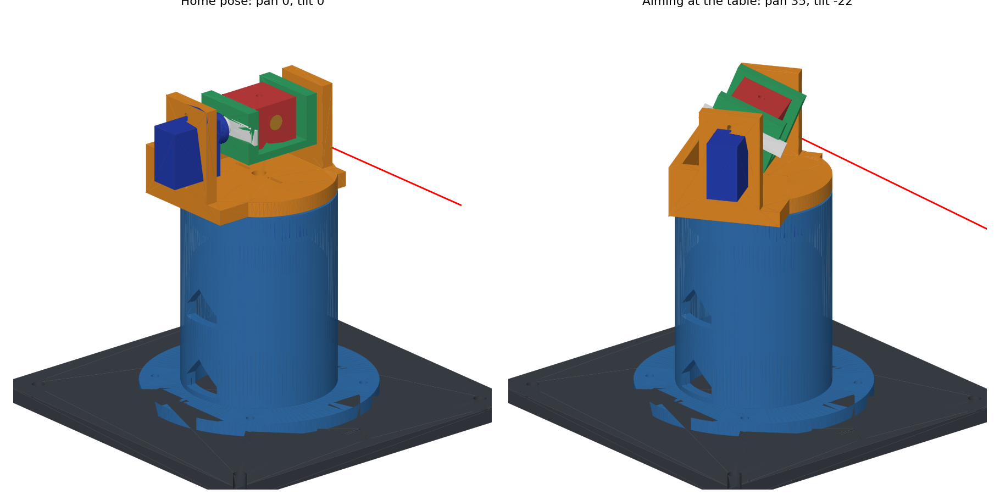
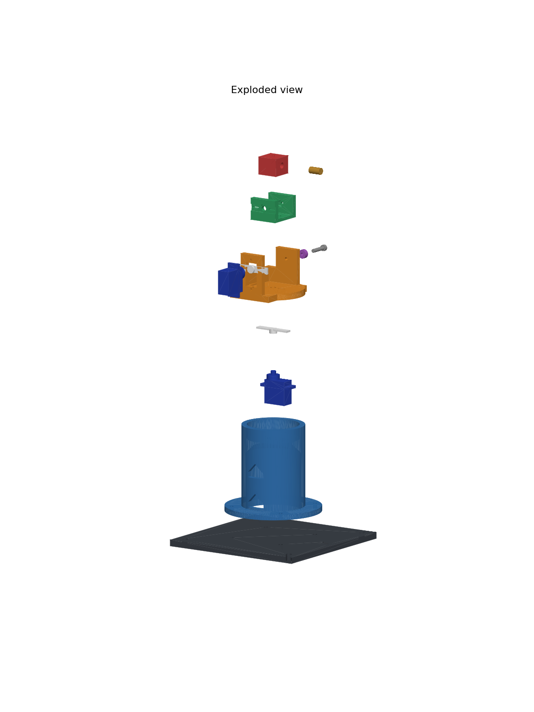

# 2-DOF Pan-Tilt Laser Arm (SG90)

A direct-drive pan-tilt arm for 3D printing, modelled in FreeCAD. It holds a laser for visual servoing on a tabletop, with targets 30-50 cm away.



- **Pan:** an SG90 in the riser rotates the yoke about the vertical axis.
- **Tilt:** an SG90 in the yoke drives the cradle, with a pivot screw supporting the other side.
- **Laser position:** the beam passes through the point where both axes cross, so aiming has no mechanical offset.
- **Height:** the tilt axis is 120 mm above the table.

## Files

| Path | Contents |
|---|---|
| `cad/arm_2dof.FCStd` | FreeCAD project: full assembly and parameter sheet |
| `cad/arm_2dof.py` | The model. All dimensions are at the top of this file |
| `cad/build_all.py` | Regenerates the FCStd, STEP and STL files |
| `cad/verify.py` | Design checks |
| `cad/render.py` | Regenerates the images in `docs/` |
| `stl/` | Print files, already in print orientation |
| `step/` | One STEP per part, plus the assembly (also opens in SolidWorks) |

## Parts to print

Print `0_fit_test` first. Sizes are as printed. Weights are for solid PLA, so real prints will be lighter.

| File | Size (mm) | Solid weight | Orientation |
|---|---|---|---|
| `0_fit_test_print_first` | 76 x 24 x 5 | 9 g | Flat |
| `1_base_plate` | 140 x 140 x 6 | 145 g | Flat |
| `2_riser` | 92 x 92 x 83 | 120 g | Flange down |
| `3_pan_yoke` | 60 x 66 x 44 | 38 g | Plate down |
| `4_tilt_cradle` | 28 x 34 x 21 | 9 g | Floor down |
| `5_laser_holder` | 17 x 20 x 20 | 8 g | Front face down |
| `6_pivot_spacer` | 8 x 8 x 4 | under 1 g | Flat |

**Suggested settings:** PLA, 0.4 mm nozzle, 0.2 mm layers, 4 walls, 30% infill. Support should not be needed: the riser's internal cone and cable windows are 45 degrees, and the remaining overhangs are short bridges. Check the preview in your slicer.

## Other parts you need

| Item | Qty | Used for |
|---|---|---|
| SG90 servo with two-arm horn | 2 | Pan and tilt |
| M2 self-tapping screw, about 6 mm | 4, plus 4 supplied with the servos | Horns to printed parts; servo ears |
| M3 x 10 screw and nut | 4 | Riser to base |
| M3 x 16 screw and nut | 1 | Tilt pivot |
| M3 washers | A few | Shim the pivot spacer gap |
| M3 x 6 screw | 3 | Laser holder (2) and laser set screw (1) |
| M4 screws or clamps | 2-4 | Fix the base to the table |
| 5 V, 650 nm laser with 6 mm barrel | 1 | Laser |

## Assembly



Centre both servos at 90 degrees with the Arduino before fitting the horns.

1. **Check the fit.** Try the servo, horn and laser in the fit-test piece (see below).
2. **Riser to base.** Press the M3 nuts into the underside of the base, then bolt the riser on with the cable windows facing the side you want.
3. **Pan servo.** Pass the plug down through the riser pocket and out of the lower window, rest the ears on the deck, and screw them into the slots.
4. **Yoke.** Screw a horn into the recess under the yoke, in the long slots. Press the horn onto the servo with the yoke facing the arrow on the base, then fit the centre screw through the hole in the yoke plate.
5. **Tilt servo.** From between the arms, pass the plug and body out through the window in the yoke arm, and screw the ears in from the inside.
6. **Cradle.** Press an M3 nut into the hexagon pocket, and screw a horn into the outer recess. Ream the hole in the pivot arm with a 3 mm drill.
7. **Fit the cradle.** Lower it between the arms, shifted towards the pivot arm, then slide it sideways so the horn engages the servo with the cradle level (servo still at 90 degrees). If you have a long, thin screwdriver (under 3 mm shaft), fit the horn centre screw through the pivot holes. If not, the spacer still stops the horn from coming off.
8. **Pivot.** Put the spacer in the gap, add washers until the side play is gone without binding, then fit the M3 x 16 screw.
9. **Laser.** Tilt the cradle to reach underneath, and bolt the holder on through the floor. Slide in the laser so it is flush at the front, then gently tighten the set screw.
10. **Cables.** Route the tilt servo cable into the upper window and out of the lower one. Leave a loose loop of about 100 mm so it can follow the pan motion. Run the servos slowly the first time, in case anything catches.

**Safety:** treat the laser as eye-unsafe. Keep the beam below eye level, and test with the laser unpowered first.

## The fit test

Print `0_fit_test` first. It takes little filament and tests every critical fit.

| Feature | Should feel like | If not, change this in `cad/arm_2dof.py` |
|---|---|---|
| Rectangular servo pocket | Slides in by hand, with no rocking | `CL_POCKET` (smaller if loose, larger if tight) |
| Ear slots | Ear holes line up over the slots | `SV_HOLE_SPACING` |
| Slot across the plate | Horn arm drops in with little side play | `CL_HORN_W` |
| Larger round hole, 6.2 mm | Laser barrel slides in snugly | `LASER_D`, `CL_BORE` |
| Smaller round hole, 3.1 mm | M3 screw turns without wobble | `M3_PIVOT` |

## Changing the design

Edit the values at the top of `cad/arm_2dof.py`, then regenerate everything:

```bash
/Applications/FreeCAD.app/Contents/Resources/bin/freecadcmd cad/build_all.py
```

```bash
/Applications/FreeCAD.app/Contents/Resources/bin/freecadcmd cad/verify.py
```

You can also open `cad/arm_2dof.py` in FreeCAD with Macro > Macros, and press Execute to rebuild the assembly with part colours.

The parts in the FCStd file are finished solids, not an editable feature history. To change a dimension, edit the script rather than the Spreadsheet sheet, which only lists the values. `build_all.py` saves the FCStd without part colours.

**Different laser:** only `5_laser_holder` needs reprinting. For another barrel size, change `LASER_D`. The holder is open at the back, so a KY-008 should fit if its head is a 6 mm barrel, with the board behind the holder. The inner cradle width is 24 mm.

## Design limits

- **Pan and tilt:** no collisions at any tested position across pan -90 to 90 and tilt -90 to 90, using a laser no longer than 12 mm. A longer laser sticks out of the back of the holder and could hit the yoke's rear wall at high up-tilt.
- **Downward aim:** the beam is blocked by the yoke plate at 39 degrees down, so the nearest reachable point on the table is about 15 cm from the pan axis. Targets at 30-50 cm need only 14-22 degrees.
- **Pan support:** the pan servo's own shaft carries the upper assembly. The riser's collar sits 0.8 mm below the turntable and only limits wobble. If it rubs, sand it down or increase `COLLAR_GAP`.

## Where the dimensions came from

No parts were measured for this design. Published SG90 sizes disagree slightly between sellers, so the design allows for variation rather than relying on exact numbers.

| Dimension | Value used | Source |
|---|---|---|
| Body 22.7 x 12.1 x 27.1 mm, overall 32.4 x 12.1 x 30.7 mm, 2.2 mm ear holes | Used directly | [SG90 data sheet (Aus Electronics Direct)](https://www.auselectronicsdirect.com.au/assets/brochures/TA0132.pdf) |
| Body 22.8 x 12.2 mm | Cross-check | [Waveshare SG90](https://www.waveshare.com/sg90-servo.htm) |
| Spline about 4.5-4.8 mm | Cross-check | [Sunservo size chart](https://sunservo.com/blog/micro-servo-size-chart/) |
| Laser barrel 6 mm | Used directly | [Oomipood laser module](https://www.oomipood.ee/en/product/oky0160_lasermoodul_650nm_5mw_5v_mini_copper_6mm_10cm_juhe) |
| Ear thickness, ear height, ear hole spacing, shaft offset | Typical values, no published source found | Unverified: check with the fit test |
| All horn dimensions | Typical values, no published source found | Unverified: horns [have no common standard](https://hackaday.io/project/180210/log/200716) |

Features that absorb this variation:

- Ear screws go into slots, not fixed holes.
- Horn screws go into long slots, so they suit any hole position along the arm.
- The cradle's horn recess is open at both ends, so horn length does not matter.
- The washers at the pivot take up differences in servo and horn height.

Pan stack height depends on the unverified horn and ear values, which is why the collar gap is on the generous side.

## Design check results

`cad/verify.py` reports 37 passed checks: collisions at 35 pan and tilt positions, watertight meshes, bed fit, beam path and assembly clearances. These checks use the model's dimensions, so they do not replace test-fitting real parts. Nothing has been printed yet.
